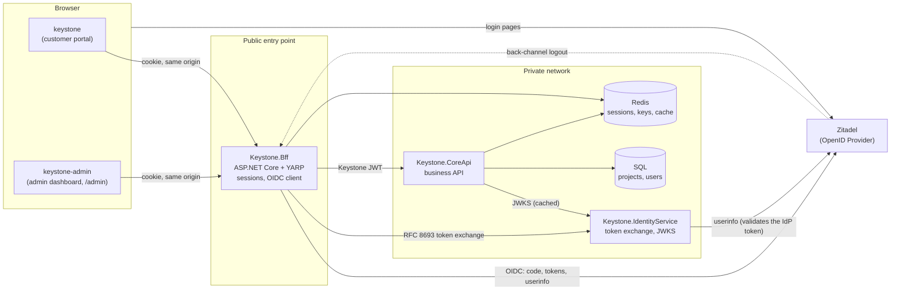
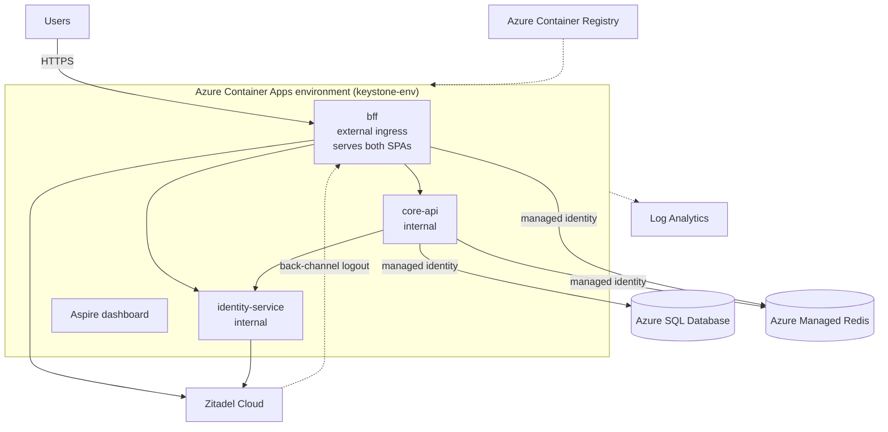

# Keystone Architecture

Keystone is a learning project: a small but realistic web platform that shows how a Backend for Frontend (BFF), OpenID Connect, internal tokens and Azure hosting fit together. The business features are deliberately thin so that the moving parts stay visible.

Related documents:

| Document | What it covers |
|----------|----------------|
| [docs/local-development.md](docs/local-development.md) | Running everything on your machine, including a local Zitadel |
| [docs/oidc-guide.md](docs/oidc-guide.md) | How login, logout and back-channel logout work, step by step, mapped to the code |
| [docs/azure-deployment.md](docs/azure-deployment.md) | Deploying to Azure Container Apps with `aspire deploy` |
| [docs/build-along.md](docs/build-along.md) | Features to build yourself to learn the architecture end to end |

---

## 1. The big picture



Three rules shape everything:

1. **The browser holds no tokens.** It has one HttpOnly cookie that names a server-side session. All tokens live in Redis, owned by the BFF.
2. **One origin.** The SPAs, the API and the login callback are all served from the BFF's host, so the cookie never crosses sites and CORS is not needed. Locally the BFF proxies the Vite dev servers; in Azure it serves the built files.
3. **Two token worlds.** Zitadel's tokens stay inside the BFF. Internal APIs only ever see short-lived *Keystone* tokens issued by the Identity Service. Swapping Zitadel for another provider touches the BFF's configuration and one class in the Identity Service, nothing else.

---

## 2. Projects

| Project | Role | Reachable from | Key files |
|---------|------|----------------|-----------|
| `Keystone.AppHost` | Aspire orchestrator: declares every resource, its wiring and its Azure mapping | (dev tool) | `Program.cs` |
| `Keystone.ServiceDefaults` | OpenTelemetry, health checks, HTTP resilience, service discovery for every .NET service | (library) | `Extensions.cs` |
| `Keystone.Bff` | OIDC client (relying party), server-side sessions (listable and revocable), token refresh, CSRF defence, reverse proxy to the Core API, static frontends, back-channel logout receiver | **Internet** | `Program.cs`, `Endpoints/`, `Services/RedisTicketStore.cs`, `Services/SessionTokenService.cs`, `Services/TokenRefresher.cs`, `Services/LogoutTokenValidator.cs` |
| `Keystone.IdentityService` | Exchanges an IdP access token for a Keystone access token; publishes its signing keys; the only code that knows Zitadel's claim formats | Private network | `Endpoints/AuthEndpoints.cs`, `Services/UserService.cs`, `Services/TokenService.cs`, `Services/KeyManager.cs` |
| `Keystone.CoreApi` | Business API (projects). Validates Keystone JWTs offline; EF Core + SQL; Redis cache | Private network | `Program.cs`, `Endpoints/ProjectEndpoints.cs`, `Data/` |
| `keystone` | Customer portal SPA (React, Vite, TanStack Router/Query) | Served by the BFF at `/` | `src/hooks/useAuth.ts`, `src/lib/api.ts` |
| `keystone-admin` | Admin dashboard SPA | Served by the BFF at `/admin/` | same as above |
| `zitadel/` | Local Zitadel (official compose file) and `setup.ps1`, which configures it for Keystone | Your machine only | `docker-compose.yml`, `.env`, `setup.ps1` |

---

## 3. Request flows

### 3.1 Login (summary)

The BFF is a confidential OIDC client using the **authorization code flow with PKCE**. The full walkthrough, with every parameter explained, is in [docs/oidc-guide.md](docs/oidc-guide.md#3-login-authorization-code-flow-with-pkce).

1. The SPA links to `GET /api/{app}/auth/login?returnUrl=...`.
2. The BFF redirects the browser to Zitadel's authorization endpoint.
3. The user signs in at Zitadel. Zitadel redirects back to `/signin-oidc` with a one-time `code`.
4. The BFF redeems the code (with its client secret and PKCE verifier), validates the ID token, calls userinfo, stores the session in Redis and sets the `__Host-keystone` cookie.

### 3.2 An API call

```mermaid
sequenceDiagram
    autonumber
    participant B as Browser (SPA)
    participant F as BFF
    participant R as Redis
    participant I as Identity Service
    participant Z as Zitadel
    participant A as Core API

    B->>F: GET /api/keystone/projects (cookie, X-CSRF: 1)
    F->>R: load session (ticket) by cookie's session id
    alt Keystone token cached for this session
        R-->>F: cached Keystone token
    else no cached token
        F->>I: POST /connect/token (token exchange, subject_token = Zitadel access token)
        I->>Z: GET /oidc/v1/userinfo (Bearer Zitadel token)
        Z-->>I: sub, name, email, project roles
        I-->>F: Keystone JWT (aud core-api, 15 min)
        F->>R: cache it until shortly before expiry
    end
    F->>A: GET /api/projects (Authorization: Bearer Keystone JWT)
    A->>A: validate signature (cached JWKS), iss, aud, exp, typ; check roles
    A-->>F: 200 JSON
    F-->>B: 200 JSON
```

YARP rewrites `/api/keystone/**` and `/api/keystone-admin/**` to `/api/**` on the Core API. The Core API does not know which frontend called it.

### 3.3 Logout and back-channel logout

* **RP-initiated logout** (`POST /api/{app}/auth/logout`): the BFF deletes its session, then sends the browser to Zitadel's `end_session_endpoint` with `id_token_hint`, so Zitadel ends its SSO session too.
* **Back-channel logout** (`POST /bff/backchannel-logout`): when a Zitadel session ends for any reason, Zitadel calls the BFF server to server with a signed *logout token*. The BFF validates it and deletes every session created from that Zitadel session (`sid`), or every session of that user (`sub`).

Both are described step by step in [docs/oidc-guide.md](docs/oidc-guide.md#6-logout).

---

## 4. Tokens and state

### 4.1 The two kinds of token

| | Zitadel tokens | Keystone access token |
|--|----------------|-----------------------|
| Issued by | Zitadel | Identity Service |
| Kinds | ID token, access token, refresh token | Access token only (JWT, `typ: at+jwt`) |
| Held by | BFF, inside the encrypted session in Redis | BFF (cached per session); sent to the Core API |
| Audience | the BFF's client id | `core-api` |
| Lifetime | Zitadel's settings (access token 12 h by default) | 15 minutes (`Jwt:LifetimeMinutes`) |
| Validated by | BFF (ID token), Zitadel (access token, via userinfo) | Core API, offline, using the Identity Service's JWKS |
| Claims used | `sub`, `sid`, `name`, `email`, project roles | `sub`, `name`, `email`, `role` |

### 4.2 Redis keys

| Key | Written by | Contents | Lifetime |
|-----|------------|----------|----------|
| `keystone:bff:session:{id}` | BFF `RedisTicketStore` | The authentication ticket (claims + Zitadel tokens), encrypted with Data Protection | Session lifetime (8 h sliding) |
| `keystone:bff:session:{id}:core-api-token` | BFF `SessionTokenService` | The cached Keystone token, encrypted | The shorter of its own and the Zitadel access token's lifetime, minus 1 minute |
| `keystone:bff:session:{id}:refresh-lock` | BFF `TokenRefresher` | Lock so only one request refreshes a session's tokens at a time | 10 seconds (released after the refresh) |
| `keystone:bff:session:sid:{sid}` | BFF | Set of session ids created from one Zitadel session | Session lifetime |
| `keystone:bff:session:sub:{sub}` | BFF | Set of session ids of one user | Session lifetime |
| `keystone:bff:logout-jti:{jti}` | BFF `LogoutTokenValidator` | Marker that a logout token was already processed (replay protection) | Token expiry + 5 minutes |
| `keystone:bff:dataprotection-keys` | ASP.NET Core Data Protection | Keys that encrypt cookies and session payloads, shared by all BFF replicas | Managed by Data Protection |
| `keystone:core-api:projects:owner:{userId}` | Core API `ProjectService` | One user's project list (one key per user, so lists are never shared) | 5 minutes |

### 4.3 SQL

The Core API owns the `keystonedb` database (tables `Users`, `Projects`). A `Users` row is created the first time someone calls the API (just-in-time provisioning in `CurrentUserService`), keyed by the identity provider's `sub` (`ExternalId`), and refreshed from later tokens. Every project belongs to the user who created it; the owner is taken from the token, never from the request. The schema is managed with EF Core migrations in `Keystone.CoreApi/Data/Migrations`, applied at startup. EF Core takes a database lock while migrating, so several replicas starting together do not race.

---

## 5. Configuration

Everything that differs between environments is an Aspire **parameter** declared in the AppHost. Locally the values come from user secrets (written by `zitadel/setup.ps1`); `aspire deploy` prompts for them and stores secret ones as Container App secrets.

| Parameter | Used by | Local value | Azure value |
|-----------|---------|-------------|-------------|
| `oidc-authority` | BFF, Identity Service | `http://localhost:8080` (default for local runs) | Your Zitadel Cloud instance URL |
| `oidc-client-id` | BFF | From `setup.ps1` | From the Zitadel Cloud app |
| `oidc-client-secret` (secret) | BFF | From `setup.ps1` | From the Zitadel Cloud app |
| `identity-signing-key` (secret, deploy only) | Identity Service | Not needed: a temporary key is generated at startup | RSA private key (PEM, base64-encoded) |

Connection strings for SQL and Redis, and the addresses of the services (`http://identity-service`, `http://core-api`), are injected by Aspire. Nothing is hard-coded per environment.

---

## 6. Running in Azure



| Azure resource | Comes from | Purpose |
|----------------|------------|---------|
| Container Apps environment + Log Analytics + Aspire dashboard | `AddAzureContainerAppEnvironment` | Hosting, internal DNS, logs, traces |
| Container Registry + user-assigned managed identity | same | Images, pulling them without passwords |
| 3 Container Apps | each `AddProject` | `bff` (external), `identity-service` and `core-api` (internal) |
| Azure SQL Database | `AddAzureSqlServer` | Entra ID only; the Core API connects with its managed identity |
| Azure Managed Redis | `AddAzureManagedRedis` | Entra ID only; BFF and Core API connect with their managed identities |
| Zitadel Cloud (not Azure) | parameter `oidc-authority` | The identity provider |

The frontends are not separate Azure resources. `PublishWithContainerFiles` builds them and copies the output into the BFF image (`wwwroot` and `wwwroot/admin`). See [docs/azure-deployment.md](docs/azure-deployment.md).

---

## 7. Key decisions

Each decision lists the alternative that was rejected, so you can revisit it consciously.

**D1. The BFF is the single origin for the SPAs, the API and the login callback.**
Rejected: Static Web Apps for the frontends with the BFF on another domain. That makes the session cookie cross-site (`SameSite=None`), which browsers increasingly block, and it needs CORS. Serving the SPAs from the BFF also means one deployable unit.

**D2. The BFF speaks OpenID Connect directly to Zitadel.**
Rejected: the Identity Service proxying the login flow. A standards-compliant OIDC provider is a large piece of software; writing one by hand is error-prone and hides how OIDC really works. The BFF uses only standard OIDC (discovery, code flow, PKCE, end-session, back-channel logout), so any compliant provider can replace Zitadel.

**D3. The Identity Service exchanges tokens instead of issuing them from scratch.**
It keeps the original promise of the design: internal services never see the IdP's tokens, and IdP-specific claim formats (Zitadel's project roles) are translated in one place. Using RFC 8693 token exchange keeps the contract standard.

**D4. Server-side sessions in Redis.**
Rejected: tokens in the encrypted cookie (the ASP.NET Core default). Cookies would grow to several kilobytes, could not be revoked server side, and back-channel logout would have nothing to delete.

**D5. The identity provider is external in every environment.**
Locally a Zitadel container stack; in Azure, Zitadel Cloud. Rejected: running Zitadel inside the Container Apps environment (it needs PostgreSQL, a login UI container and careful upgrades; operating an IdP is not what this project is about).

**D6. Aspire 13 with `aspire deploy`.**
Aspire 9 is out of support. Aspire 13 generates the Bicep, builds the images and deploys them; it also supports passwordless SQL and Redis through managed identities out of the box.

---

## 8. Security summary

| Threat | Defence | Where |
|--------|---------|-------|
| Token theft through XSS | No tokens in the browser; HttpOnly session cookie | BFF |
| Session fixation / cookie tampering | `__Host-` cookie, Secure, server-side session ids, Data Protection | BFF `Program.cs` |
| CSRF on the API | Unsafe methods require `X-CSRF: 1` (a cross-site page cannot add it without a CORS preflight); `SameSite=Lax` | BFF `Program.cs` |
| Authorization code interception | PKCE (S256) + confidential client secret | BFF OIDC options |
| Login CSRF / replayed ID tokens | `state` (correlation cookie) and `nonce` | ASP.NET Core OIDC handler |
| Open redirect after login | `returnUrl` must be a local path | `HttpContextExtensions.IsLocalUrl` |
| Forged or replayed logout tokens | Signature, issuer, audience, lifetime, `events`, no `nonce`, `jti` replay cache | `LogoutTokenValidator` |
| Stolen internal token | 15-minute lifetime, audience-bound (`core-api`), never leaves the server side | Identity Service |
| Unattended session used for destructive actions | Step-up (RFC 9470): DELETE needs `auth_time` within 5 minutes, otherwise `insufficient_user_authentication` and a `prompt=login` round trip | BFF `Middleware/RecentAuthentication.cs` |
| Abuse | Per-user fixed-window rate limit on the proxied API | BFF |
| Secrets in config | Managed identities for SQL/Redis; client secret and signing key as Container App secrets | AppHost |

Known gaps, good next steps (several are build-along exercises):

* The Identity Service's `/connect/token` relies on network isolation; it does not authenticate its caller.
* The signing key is not rotated; the JWKS only ever contains one key.
* Health endpoints are only mapped in Development; Container Apps health probes are not configured.

---

## 9. Technology

| Area | Choice |
|------|--------|
| Runtime | .NET 10, ASP.NET Core 10 |
| Orchestration and deployment | Aspire 13.6 (AppHost, ServiceDefaults, `aspire deploy`) |
| Reverse proxy | YARP 2.3 with Aspire service discovery |
| Identity provider | Zitadel v4 (local Docker Compose; Zitadel Cloud in Azure) |
| Data | EF Core 10 on SQL Server / Azure SQL; Redis / Azure Managed Redis |
| Frontends | React 19, TypeScript 5.9, Vite 6, TanStack Router and Query, Tailwind CSS 4 |
| Observability | OpenTelemetry to the Aspire dashboard (locally and in Azure) and Log Analytics |
| Package management | Central package management (`Directory.Packages.props`), exact versions |
