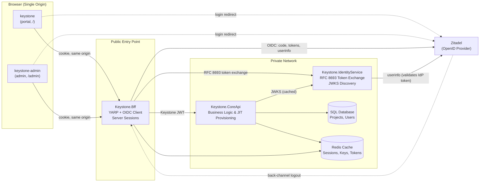

<div align="center">

# 🏛️ Keystone

### Secure web platform reference architecture on .NET 10 & Azure Container Apps

[](https://github.com/akazad13/keystone/actions)
[](https://dotnet.microsoft.com/)
[](https://react.dev/)
[](https://www.typescriptlang.org/)
[](https://learn.microsoft.com/en-us/dotnet/aspire/)
[](https://zitadel.com/)
[](LICENSE)

[Overview](#-overview) •
[Architecture](#-architecture) •
[Tech Stack](#-tech-stack) •
[Repository Layout](#-repository-layout) •
[Quick Start](#-quick-start) •
[Testing](#-testing) •
[Documentation](#-documentation)

</div>

---

## 📌 Overview

**Keystone** is a production-grade reference architecture for building secure web platforms on .NET 10 and Azure. It demonstrates how a Backend for Frontend (BFF), OpenID Connect (including back-channel logout), internal RFC 8693 token exchange, and Azure hosting integrate cleanly. The business features are deliberately focused so that all security and architectural components remain transparent and easy to trace.

### Key Highlights
- 🛡️ **Cookie-Only in Browser**: The browser holds zero tokens. It receives a single `__Host-` HttpOnly, Secure, SameSite session cookie mapped to encrypted Redis server-side state.
- 🌐 **Single Origin**: Customer portal, admin dashboard, Core API reverse proxy, and OIDC callback all resolve from the BFF origin, eliminating third-party cookie restrictions and CORS overhead.
- 🔑 **Two Token Worlds**: Upstream IdP (Zitadel) tokens stay strictly inside the BFF. Downstream internal APIs only accept short-lived Keystone tokens issued by the Identity Service.
- ⚡ **Step-Up Authentication**: Enforces RFC 9470 step-up authentication (`max_age=300`) on sensitive DELETE operations, prompting re-authentication when sessions exceed 5 minutes.
- ☁️ **Cloud-Native Aspire Deployment**: Orchestrated locally and mapped to Azure Container Apps, Azure SQL, and Azure Managed Redis with managed identities using `aspire deploy`.

---

## 🏛 Architecture



> [!NOTE]
> Detailed sequence diagrams, token lifecycles, and threat mitigations are fully documented in [ARCHITECTURE.md](ARCHITECTURE.md) and [docs/oidc-guide.md](docs/oidc-guide.md).

---

## 🛠 Tech Stack

| Domain | Technologies |
| :--- | :--- |
| **Backend & Orchestration** | .NET 10, ASP.NET Core, Aspire 13.6 (`Keystone.AppHost`, `Keystone.ServiceDefaults`) |
| **Reverse Proxy & BFF** | YARP 2.3, Microsoft.AspNetCore.Authentication.OpenIdConnect, RedisTicketStore |
| **Identity & Security** | Zitadel v4 (OIDC & PKCE), RFC 8693 Token Exchange, RFC 9470 Step-Up Authentication |
| **Data & Cache** | EF Core 10, SQL Server / Azure SQL, Redis / Azure Managed Redis |
| **Frontends** | React 19, TypeScript 5.7, Vite 6, TanStack Router & Query, Tailwind CSS 4 |
| **Observability** | OpenTelemetry, Aspire Dashboard, Azure Log Analytics |
| **Testing** | xUnit v3 (services, hand-written fakes), Vitest 3.2 + RTL (frontends), Playwright 1.63 (E2E) |

---

## 📂 Repository Layout

```text
├── Keystone.AppHost/          # Aspire AppHost: resource declarations, wiring, Azure mapping
├── Keystone.ServiceDefaults/  # Telemetry, health checks, HTTP resilience, service discovery
├── Keystone.Bff/              # Public entry: OIDC client, Redis sessions, proxy, static SPAs
├── Keystone.IdentityService/  # Internal token service (RFC 8693 token exchange, JWKS)
├── Keystone.CoreApi/          # Business API (EF Core, SQL Server, Redis cache)
├── keystone/                  # Customer portal SPA (React 19, Vite, TanStack Router)
├── keystone-admin/            # Admin dashboard SPA (React 19, Vite, TanStack Router)
├── zitadel/                   # Local Zitadel compose stack and setup automation scripts
├── tests/                     # Fast unit and integration tests (xUnit v3, no Docker needed)
├── e2e/                       # End-to-end browser tests (Playwright) against live stack & Zitadel
├── docs/                      # In-depth architectural guides, OIDC walk-throughs, and deployment
└── Directory.Packages.props   # Central package management (pinned NuGet versions)
```

---

## 🚀 Quick Start

### Prerequisites
- [.NET 10 SDK](https://dotnet.microsoft.com/)
- [Node.js 22+](https://nodejs.org/)
- [Docker Desktop](https://www.docker.com/)
- [PowerShell 7 (`pwsh`)](https://github.com/PowerShell/PowerShell)
- Trusted dev certificate: `dotnet dev-certs https --trust`

### 1. Initialize Local Identity Provider
```powershell
cd zitadel
docker compose up -d --wait
pwsh ./setup.ps1          # Configures project, OIDC app, users alice/bob, and AppHost secrets
cd ..
```

### 2. Install Frontend Dependencies
```powershell
cd keystone; npm install; cd ..
cd keystone-admin; npm install; cd ..
```

### 3. Run the Stack
```powershell
dotnet run --project Keystone.AppHost
```

- **Customer Portal**: <https://localhost:7003>
- **Admin Dashboard**: <https://localhost:7003/admin/>
- **Test Credentials**: Sign in as `alice` (Admin) or `bob` (User). Password is listed in `zitadel/setup.ps1`.
- **Aspire Dashboard**: The local dashboard URL is printed in the terminal.

---

## 🧪 Testing

| Test Suite | Scope | Command |
| :--- | :--- | :--- |
| **.NET Services** | Unit and integration tests for BFF, Identity Service, Core API | `dotnet test` |
| **Customer Portal** | Component, hook, API client, and routing tests | `npm --prefix keystone test` |
| **Admin Dashboard** | Admin component and API integration tests | `npm --prefix keystone-admin test` |
| **End-to-End** | Full browser flows through Zitadel login and back-channel logout | `npm --prefix e2e test` |

---

## 📚 Documentation

| Guide | Description |
| :--- | :--- |
| 🏛️ [ARCHITECTURE.md](ARCHITECTURE.md) | Component architecture, token boundaries, Redis key design, and decision log |
| 🔐 [docs/oidc-guide.md](docs/oidc-guide.md) | Step-by-step walkthrough of login, PKCE, token refresh, and back-channel logout |
| 💻 [docs/local-development.md](docs/local-development.md) | Running, debugging, and inspecting services and traces locally |
| ☁️ [docs/azure-deployment.md](docs/azure-deployment.md) | Azure Container Apps deployment with `aspire deploy` and Zitadel Cloud |
| 🛠️ [docs/build-along.md](docs/build-along.md) | Hands-on exercises: from session listing to step-up authentication |

---

## 👤 Author

**Md. Abul Kalam**
- GitHub: [@akazad13](https://github.com/akazad13)
- LinkedIn: [Md. Abul Kalam](https://linkedin.com/in/akazad13)

---

## 📄 License

This project is licensed under the [MIT License](LICENSE).
