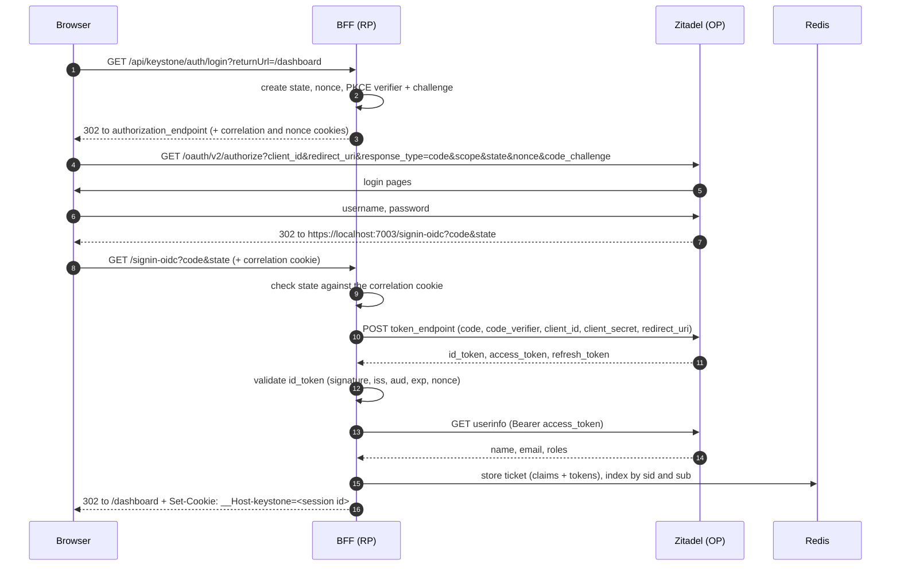
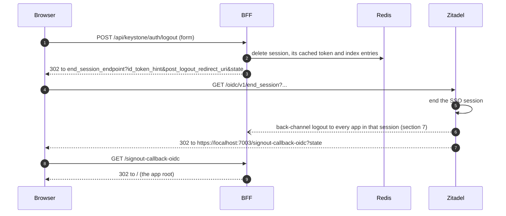
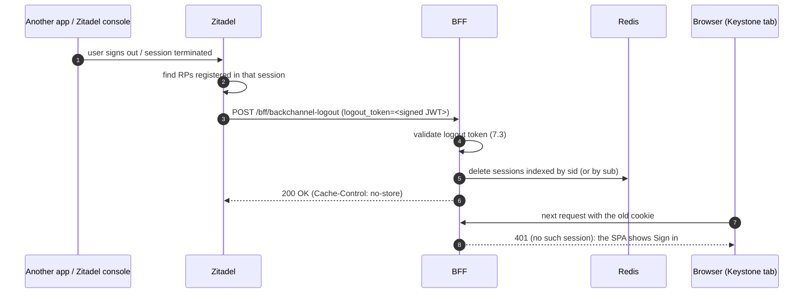

# OpenID Connect in Keystone: a guided tour

This guide walks through every OIDC interaction Keystone performs, in the order they happen, and points at the code that does each step and at a way to observe it yourself. Read it with the app running locally ([local-development.md](local-development.md)) and your browser's developer tools open.

Contents:

1. [The cast](#1-the-cast)
2. [Discovery](#2-discovery)
3. [Login: authorization code flow with PKCE](#3-login-authorization-code-flow-with-pkce)
4. [The session](#4-the-session)
5. [Calling the API: token exchange](#5-calling-the-api-token-exchange)
6. [Logout](#6-logout)
7. [Back-channel logout](#7-back-channel-logout)
8. [Why each defence exists](#8-why-each-defence-exists)
9. [Troubleshooting](#9-troubleshooting)

---

## 1. The cast

| OIDC / OAuth name | In Keystone | Notes |
|-------------------|-------------|-------|
| End user | You, in the browser | |
| User agent | The browser | Only ever holds a session cookie |
| OpenID Provider (OP), authorization server | Zitadel (`http://localhost:8080`) | Authenticates users, issues ID/access/refresh tokens |
| Relying Party (RP), client | `Keystone.Bff` | A *confidential* client: it has a client secret and runs on a server |
| Resource server | `Keystone.CoreApi` | Accepts only Keystone access tokens |
| Security Token Service (RFC 8693) | `Keystone.IdentityService` | Swaps Zitadel access tokens for Keystone access tokens |

The setup script registers the BFF in Zitadel as a **web application** with:

| Setting | Value | Why |
|---------|-------|-----|
| Response type | `code` | Authorization code flow |
| Grant types | `authorization_code`, `refresh_token` | Login, plus refresh (a build-along exercise) |
| Client authentication | `client_secret_post` | The ASP.NET Core handler sends the secret in the token request body |
| Redirect URI | `https://localhost:7003/signin-oidc` | Where Zitadel sends the browser after login |
| Post-logout redirect URI | `https://localhost:7003/signout-callback-oidc` | Where Zitadel sends the browser after logout |
| Back-channel logout URI | `http://host.docker.internal:5003/bff/backchannel-logout` | Where Zitadel posts logout tokens (server to server) |
| Project role assertion | on | Puts the user's roles in userinfo |

You can see all of it in the Zitadel console: **Projects > Keystone > keystone-bff**.

---

## 2. Discovery

Neither the BFF nor the Identity Service hard-codes Zitadel's endpoints. They are configured with only the **authority** (issuer URL) and read the rest from the discovery document.

**See it:** open <http://localhost:8080/.well-known/openid-configuration>. The fields Keystone uses:

| Field | Used for |
|-------|----------|
| `issuer` | Must equal the `iss` claim of every ID token and logout token |
| `authorization_endpoint` | Where the browser is sent to log in |
| `token_endpoint` | Where the BFF redeems the code |
| `userinfo_endpoint` | Extra claims for the BFF; token validation for the Identity Service |
| `jwks_uri` | Zitadel's public keys, used to check ID token and logout token signatures |
| `end_session_endpoint` | RP-initiated logout |
| `backchannel_logout_supported`, `backchannel_logout_session_supported` | Zitadel can send logout tokens, and they include `sid` |

**Code:** `options.Authority` in `Keystone.Bff/Program.cs`; `ConfigurationManager<OpenIdConnectConfiguration>` in `Keystone.IdentityService/Program.cs`. Both cache the document and refresh it periodically, so key rotation at Zitadel is picked up automatically.

The Identity Service publishes a discovery document of its own for internal consumers, at `/.well-known/openid-configuration`. The Core API reads it to learn the Keystone issuer name and where the Keystone signing keys are.

---

## 3. Login: authorization code flow with PKCE



### Step by step

**1-3. Starting the login.** The SPA does not build any OIDC URL. It links to the BFF (`loginUrl()` in `src/lib/api.ts`), and the BFF's `HandleLogin` (`Keystone.Bff/Endpoints/AuthEndpoints.cs`) returns a *challenge* for the OpenID Connect scheme. The ASP.NET Core OIDC handler then generates:

| Parameter | What it is | Protects against |
|-----------|-----------|------------------|
| `state` | Encrypted blob carrying `returnUrl` and a correlation id; a matching correlation cookie is set | Login CSRF: a callback that this browser did not start is rejected |
| `nonce` | Random value, also stored in a cookie; Zitadel copies it into the ID token | ID token replay |
| `code_verifier` / `code_challenge` | PKCE: a random secret and its SHA-256 hash; only the hash is sent now | Stolen authorization codes are useless without the verifier |
| `scope` | `openid profile email offline_access urn:zitadel:iam:org:projects:roles` | `openid` makes it OIDC; `offline_access` asks for a refresh token; the last one asks Zitadel for project roles |
| `response_type=code` | Authorization code flow | Tokens never travel through the browser |

The `returnUrl` is checked by `IsLocalUrl` first. Without that check, `/auth/login?returnUrl=https://evil.example` would send freshly logged-in users to an attacker's page (an *open redirect*).

**See it:** DevTools > Network, tick "Preserve log", click **Sign in**. Find the `authorize` request and read its query string.

**4-6. At Zitadel.** The user authenticates. Keystone takes no part in this: password rules, MFA and passkeys are all configured in Zitadel. Zitadel then redirects back to the **registered** redirect URI with a one-time `code`.

**7-9. Redeeming the code.** The BFF's OIDC handler owns `/signin-oidc` (`options.CallbackPath`). It checks `state`, then posts to the token endpoint with the `code`, the PKCE `code_verifier` and its client credentials. Only a party that knows both the client secret and the verifier can redeem the code.

> Why `ResponseMode = Query`? The default for the code flow in ASP.NET Core is `form_post`, a cross-site POST back to the BFF. A top-level GET redirect is simpler to observe and works with `SameSite=Lax` cookies. Both are secure with PKCE.

**10. Validating the ID token.** The handler checks the signature against Zitadel's JWKS, `iss`, `aud` (must be our client id), `exp`, and that `nonce` matches the cookie. Decode an ID token at <https://jwt.io> to see its claims. The two that matter most here:

* `sub`: the user's stable id at Zitadel.
* `sid`: the id of the user's **Zitadel session**. Back-channel logout uses it later.

**11-12. Userinfo.** `GetClaimsFromUserInfoEndpoint = true` fetches profile claims that are not in the ID token.

**13-14. Creating the session.** The cookie handler signs the user in. Because `CookieAuthenticationOptions.SessionStore` is set, the ticket (claims plus the three Zitadel tokens, since `SaveTokens = true`) goes to `RedisTicketStore.StoreAsync`. That method:

* stores the ticket in Redis, encrypted with Data Protection,
* indexes the session under `sid` and `sub` (for back-channel logout),
* returns a random session id, which is the only thing the cookie contains.

**See it:** after login, list the keys in Redis (command in [local-development.md](local-development.md#inspecting-redis)). You will find `keystone:bff:session:<id>` plus the two index sets.

---

## 4. The session

The cookie `__Host-keystone`:

| Attribute | Value | Why |
|-----------|-------|-----|
| `HttpOnly` | yes | JavaScript (including injected scripts) cannot read it. Try `document.cookie` in the console: it is not there. |
| `Secure` | yes | Only sent over HTTPS |
| `__Host-` prefix | | The browser refuses it unless it is Secure, has `Path=/` and no `Domain`, so a subdomain cannot overwrite it |
| `SameSite` | `Lax` | Sent on top-level navigations (needed when Zitadel redirects back) but not on cross-site POSTs, `fetch` calls or iframes. `Strict` would drop the cookie on the redirect back from Zitadel. |
| Content | random session id, encrypted | The real data is in Redis |
| Lifetime | 8 hours, sliding | Independent of Zitadel's token lifetimes |

`GET /api/{app}/me` returns the session's claims. The SPAs call it to decide whether to show the app or a **Sign in** button (`useAuth.ts`).

---

## 5. Calling the API: token exchange

The Core API never receives a Zitadel token. When a request for `/api/keystone/**` arrives, the YARP transform in `Keystone.Bff/Program.cs` calls `SessionTokenService.GetAccessTokenAsync`:

1. If a Keystone token is cached for this session, use it.
2. Make sure the session's Zitadel access token is still valid; if it expires within a minute, refresh it first (section 5.1).
3. Post an **RFC 8693 token exchange** to the Identity Service:

   ```http
   POST /connect/token
   Content-Type: application/x-www-form-urlencoded

   grant_type=urn:ietf:params:oauth:grant-type:token-exchange
   &subject_token=<Zitadel access token>
   &subject_token_type=urn:ietf:params:oauth:token-type:access_token
   &audience=core-api
   ```

4. The Identity Service (`AuthEndpoints.HandleTokenExchange`) calls Zitadel's **userinfo** endpoint with the subject token. If Zitadel answers 401, the token is invalid, expired or revoked, and the exchange fails with `invalid_grant`. This works whatever the format of Zitadel's access token (JWT or opaque).
5. `UserService` maps Zitadel's claims to a Keystone user, including Zitadel's role format (`urn:zitadel:iam:org:project:roles`), and `TokenService` signs a JWT:

   ```json
   { "typ": "at+jwt", "alg": "RS256", "kid": "<thumbprint>" }
   {
     "iss": "https://identity.keystone.internal",
     "aud": "core-api",
     "sub": "394975446455812099",
     "name": "Alice Admin",
     "email": "alice@keystone.localhost",
     "role": ["Admin", "User"],
     "exp": 1791921000, "iat": 1791920100, "jti": "..."
   }
   ```

6. The Core API (`Keystone.CoreApi/Program.cs`) validates it **offline**: signature with the cached JWKS from the Identity Service, `iss`, `aud = core-api`, `exp`, and `typ = at+jwt`. `RequireRole("Admin")` then reads the `role` claim.

**See it:** in the Aspire dashboard's **Traces**, open a `GET /api/keystone/{**catch-all}` trace. The first call in a session shows the `identity-service` hop and its call to Zitadel. Later calls go straight from the BFF to `core-api`. To read a Keystone token, post it to the Identity Service's introspection endpoint (`/internal/introspect`, form field `token`).

### 5.1 Refreshing Zitadel's access token

Zitadel's access token expires (12 hours by default) long before the 8-hour sliding session would. `TokenRefresher` (`Keystone.Bff/Services/TokenRefresher.cs`) keeps it usable:

```http
POST /oauth/v2/token
Content-Type: application/x-www-form-urlencoded

grant_type=refresh_token&refresh_token=<from the session>&client_id=...&client_secret=...
```

Things to notice in the code:

* **Rotation.** Zitadel returns a *new* refresh token each time and the old one stops working, so the new one is saved into the session immediately.
* **In-place update.** The session is rewritten with `RedisTicketStore.RenewAsync` under the same id. `HttpContext.SignInAsync` would mint a new session id, and every other request still carrying the old cookie would fail.
* **One refresh at a time.** With rotation, two simultaneous refreshes would make the second one present an already-used refresh token. A Redis lock (`...:refresh-lock`) serializes them; the waiting request re-reads the session and finds the fresh token.
* **Rejected means over.** If Zitadel answers `invalid_grant` (refresh token expired, revoked, or its SSO session ended), the session is deleted and the user gets a clean 401.
* **The cache follows the upstream token.** A cached Keystone token never lives longer than the Zitadel access token it was exchanged from.

**See it:** shorten the access token lifetime in the Zitadel console (Default settings > OIDC token lifetimes and expiration, e.g. 2 minutes), sign in, wait a little over a minute, and call the API. The Aspire trace shows the BFF calling Zitadel's token endpoint before the token exchange. Fire several calls at once (`Promise.all` in the browser console): Zitadel's log still shows only one refresh.

---

## 6. Logout

### 6.1 RP-initiated logout (the Sign out button)



* The button is a **form POST**, not a link. A link (GET) could be triggered by any page (an `` would do), logging users out against their will.
* `HandleLogout` signs out of both schemes: the cookie scheme deletes the Redis session (`RedisTicketStore.RemoveAsync`); the OIDC scheme builds the redirect to Zitadel.
* `id_token_hint` tells Zitadel which session and client the request is about. Zitadel only redirects to a `post_logout_redirect_uri` registered for that client.

### 6.2 Why logging out of Keystone is not enough

Deleting the BFF session logs the user out of Keystone, but their **Zitadel session** (the single sign-on session) would still be alive. The next **Sign in** would then succeed without a password. Calling `end_session` ends that too. And because other applications may share the Zitadel session, Zitadel tells them as well. That is back-channel logout.

---

## 7. Back-channel logout

Specification: [OpenID Connect Back-Channel Logout 1.0](https://openid.net/specs/openid-connect-backchannel-1_0.html).

### 7.1 The idea

When a Zitadel session ends (the user signs out in *any* application, or the session is terminated), Zitadel sends an HTTP POST **directly from its server to each relying party** that was part of the session. No browser is involved, so it works even if the user closed the tab, and it cannot be blocked by browser privacy features. (Front-channel logout, the older alternative, loads each app's logout URL in hidden iframes, and modern third-party cookie blocking breaks it.)



### 7.2 The logout token

The body is a form with one field, `logout_token`, a JWT signed with Zitadel's keys. Decoded:

```json
{
  "iss": "http://localhost:8080",
  "aud": ["<the BFF's client id>"],
  "iat": 1791920480,
  "exp": 1791921380,
  "jti": "394975733446868995",
  "sub": "394975446455812099",
  "sid": "V2_394975597870186499",
  "events": { "http://schemas.openid.net/event/backchannel-logout": {} }
}
```

`sid` matches the `sid` in the ID token received at login, which is why the BFF indexes sessions by it.

### 7.3 Validating it (`Keystone.Bff/Services/LogoutTokenValidator.cs`)

The spec's validation steps (section 2.6), in the order the code performs them:

| Check | Why |
|-------|-----|
| Signature with Zitadel's JWKS, `iss` = Zitadel, `aud` contains our client id, not expired | Anyone can POST to the endpoint; only Zitadel can sign for our client |
| `events` contains `http://schemas.openid.net/event/backchannel-logout` | It is a logout token, not some other JWT from the same issuer |
| No `nonce` claim | An ID token (which has a nonce) can never be passed off as a logout token |
| `sid` or `sub` present | The token must say what to log out |
| `jti` not seen before (Redis, `SET NX`) | The same token cannot be replayed |

Then `BackChannelLogoutEndpoints` deletes the sessions: by `sid` when present (just that Zitadel session), otherwise by `sub` (all of the user's sessions). It answers `200` with `Cache-Control: no-store`, or `400` when validation fails.

### 7.4 Try it

1. Sign in to the portal at <https://localhost:7003>.
2. List the session keys in Redis: you will see `keystone:bff:session:<id>` and `keystone:bff:session:sid:<sid>`.
3. **Without** using Keystone's Sign out button, end the Zitadel session directly: open `http://localhost:8080/oidc/v1/end_session?client_id=<oidc-client-id>` (the client id is in the AppHost user secrets: `dotnet user-secrets list --project Keystone.AppHost`) and pick the account. This is exactly what happens when the user signs out of *another* application.
4. Watch:
   * the Zitadel log: `docker compose -f zitadel/docker-compose.yml logs zitadel-api | Select-String back_channel_logout`
   * the Aspire dashboard: a `POST /bff/backchannel-logout` trace
   * Redis: the session keys are gone, and a `keystone:bff:logout-jti:<jti>` key appeared
5. Go back to the portal tab and focus it. `useAuth` refetches `/me`, gets `401` and shows **Sign in**, although the browser still holds the old cookie.

### 7.5 What back-channel logout does not do

* **Tokens already issued stay valid until they expire.** A Keystone token cached by the BFF is deleted with the session, so nothing can use it afterwards. But the Core API validates tokens offline and would accept a copy until its `exp` (at most 15 minutes). This is the trade-off of offline validation, and the reason internal tokens are short-lived.
* **Open pages are not notified instantly.** The SPA finds out on its next call to the BFF. Pushing the event to the browser (Server-Sent Events, SignalR) is a nice extension.
* **The BFF does not call Zitadel's token revocation endpoint.** It simply deletes the Zitadel tokens it held, so nobody has them any more. Calling `revocation_endpoint` on RP-initiated logout is a small, worthwhile extension.

---

## 8. Why each defence exists

| Defence | Attack it stops | Try removing it and... |
|---------|-----------------|------------------------|
| Tokens only on the server | XSS stealing tokens | ...an injected script could read `localStorage` and call the API from anywhere |
| PKCE | Authorization code interception | ...a code leaked through logs or a malicious app could be redeemed |
| `state` | Login CSRF (attacker logs you into *their* account) | ...a forged callback would be accepted |
| `nonce` | ID token replay | ...an old ID token could be injected into a new login |
| `SameSite=Lax` + `X-CSRF` header | Cross-site request forgery against the API | ...another site could POST to `/api/keystone/projects` with your cookie |
| Logout is POST-only | Forced logout | ...any page could sign you out with an image tag |
| `IsLocalUrl` on `returnUrl` | Open redirect | ...phishing links could bounce through your login page |
| Logout token checks | Forged or replayed logout tokens | ...anyone could log users out by POSTing a JWT |
| Audience `core-api` on Keystone tokens | Token reuse at another API | ...a token for one API would work at another |

---

## 9. Troubleshooting

| Symptom | Likely cause |
|---------|--------------|
| Login returns 500 "Unable to obtain configuration from http://localhost:8080/..." | Zitadel is not running: `docker compose -f zitadel/docker-compose.yml up -d --wait` |
| Zitadel shows "redirect_uri is missing in the client configuration" | You opened the app on a different URL than `https://localhost:7003`. Always use the BFF's URL. |
| Login loops back to Zitadel | The `__Host-keystone` cookie was not stored: you are not on HTTPS, or the dev certificate is not trusted (`dotnet dev-certs https --trust`) |
| API calls return 401 right after login | Token exchange failed. Check the Identity Service logs in the dashboard (wrong `oidc-authority`, Zitadel unreachable). |
| API calls return 403 | The user lacks the role. Check the user's authorizations in the Zitadel console (Users > the user > Authorizations). |
| Back-channel logout never arrives | The app's back-channel URI must use `host.docker.internal:5003` (Zitadel runs in Docker); the deny list in `zitadel/.env` must allow it; the AppHost must be running. |
| `invalid_grant` from `/connect/token` | The Zitadel access token was rejected by userinfo. Normally `TokenRefresher` renews it first; check the BFF logs for a failed refresh. |
